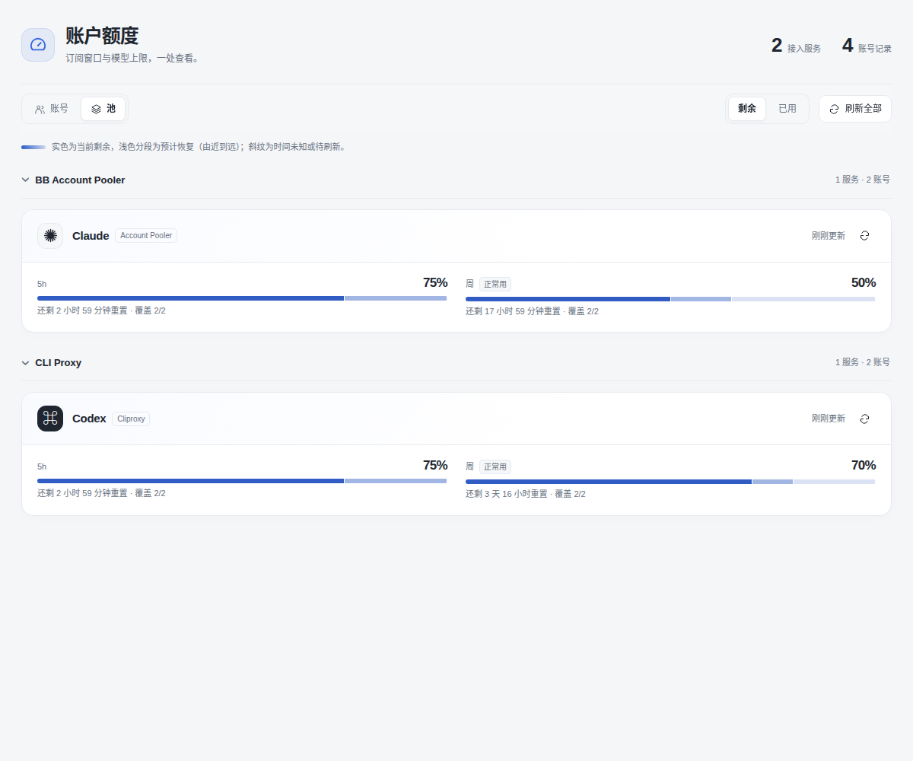

# BB Account Limits

在 BB 中查看订阅额度、账号池、重置分段和周使用节奏。不同来源独立统计，可折叠并记住状态。



- **BB Account Pooler**：自动读取已启用的 Claude、Codex 账号，无须复制登录凭证。
- **CLI Proxy**：可选来源，配置后才出现。没有配置时不显示，也不发送代理请求。
- 保留账号/池视图、剩余/已用切换、重置倒计时、Claude 总周与模型上限关系。
- 池视图标明“整池节奏”，直接显示最近重置的一批账号还有多少周额度、是否耗尽或 5h 暂受限；多账号悬停查看各自余量。摘要始终显示剩余，不随“已用”模式倒转。
- 周建议为“可多用 / 正常用 / 节约用”，数据缺失或过时则暂不判断。多账号分别计算重置时间，临期宽裕账号放在悬停解释中。

安装：

```sh
bb plugin install 'git:https://github.com/hxy91819/bb-plugin-account-limits.git@v0.3.4' --yes
```

也可从 GitHub Releases 下载 `.tgz` 和校验文件，验证后解压，先执行 `npm install --prefix ./package --omit=dev --omit=optional --ignore-scripts` 安装声明的依赖，再执行 `bb plugin install ./package --yes`。本地路径安装会重建前端，因此解压安装也需要 Node.js 22+。需要支持 Plugin SDK 0.6.37 的 BB；源码安装需要 Node.js 22+。安装包是跨平台 JavaScript，不携带本机凭证。

在侧栏打开“账户额度”。如果只使用 BB Account Pooler，不用创建配置文件。

使用 CLI Proxy 时，在**需要查询代理的机器**创建 `~/.config/bb/account-limits/local.json`：

```json
{
  "cliproxy": {
    "managementBaseUrl": "http://127.0.0.1:8317/v0/management",
    "managementKeyEnv": "CLIPROXY_MANAGEMENT_KEY"
  }
}
```

密钥放进 BB host 进程环境，也可用 `managementKeyFile` 指向密钥文件，环境变量优先。配置后 `bb plugin reload account-limits`。没有配置的机器会自动跳过，已配置但查询失败的来源仍显示错误或缓存。

默认发现代理中全部 OAuth 账号；可用顶层 `enabledProviders` 筛选供应商，用 `accounts` 覆盖显示名、权重或隐藏账号。省略 `cliproxy`、设为 `null` 或 `enabled: false` 都会停用来源。API Key 路由不在 OAuth 账号发现范围；没有 Muse 用量信号时也不会伪造百分比。

该插件不统计对话 token 或预估 API 费用，也不注册可执行 Agent；这些由 BB Usage 和相应 Provider 负责。旧本机工具中的可选 ACP 启动器不属于本开源版，如使用过，需要单独配置。

详见英文 README、[架构](architecture.md)和[算法](../weekly-pace.md)。
